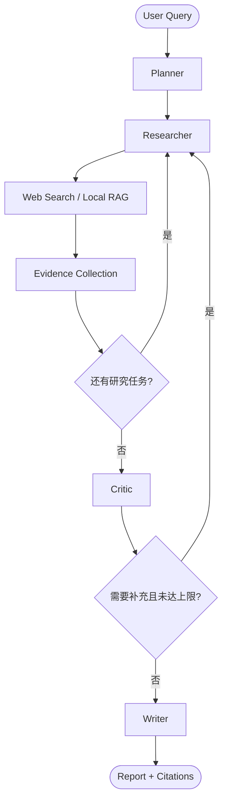

# DeepResearch Agent

一个用于学习与项目展示的 Python + LangGraph 研究 Agent：将复杂问题拆成研究任务，在 Web Search 与本地 RAG 之间选择工具，收集带来源的证据，通过逐要求评估决定是否补充研究，最后生成带引用的 Markdown 报告。

当前具备 CLI、FastAPI、离线展示案例、基础评估和 Docker 配置。容器配置尚未在本机实际构建验证，最终交付验收仍需完成。

## 快速开始

以下命令在项目根目录执行，使用 PowerShell。当前本机验证环境为 Windows / Python 3.14；Docker 使用 Python 3.14 的 Linux 镜像。依赖使用兼容版本范围，尚未提供依赖锁文件。

```powershell
python -m venv .venv
.\.venv\Scripts\python.exe -m pip install -r requirements.txt
if (-not (Test-Path .env)) { Copy-Item .env.example .env }
.\.venv\Scripts\python.exe main.py --check-config
```

在 `.env` 中填写以下配置，已有 `.env` 时不要重新复制覆盖：

| 用途 | 配置 |
| --- | --- |
| Planner / Researcher / Critic / Writer | `DR_API_KEY`、`DR_API_BASE_URL`、`DR_MODEL_NAME` |
| Web Search | `DR_TAVILY_API_KEY` |
| BGE-M3 embedding | `DR_EMBEDDING_API_KEY`、`DR_EMBEDDING_BASE_URL`、`DR_EMBEDDING_MODEL` |

LLM 接口使用兼容 OpenAI 的 HTTP 协议。默认 embedding 配置为 `BAAI/bge-m3`，通过 SiliconFlow 的 `/embeddings` 接口调用，使用 dense 向量；没有实现 BGE-M3 的 sparse / multi-vector 检索。`DR_EMBEDDING_DIMENSIONS=1024` 用于本地 hashing 模式，API 模式可用 `DR_EMBEDDING_EXPECTED_DIMENSIONS` 额外限制返回维度。

密钥通过环境变量或本地 `.env` 注入，源码不提供默认密钥。`.env` 已被 Git 和 Docker 构建上下文排除。完整配置项见 [.env.example](.env.example)。

### 无 API 的展示与测试

```powershell
.\.venv\Scripts\python.exe -m unittest discover -s tests
.\.venv\Scripts\python.exe -m pip check
.\.venv\Scripts\python.exe -m examples.showcase --output reports/showcase
```

展示脚本使用真实 LangGraph、真实 FAISS 和演示文档，但 embedding 使用本地 hashing，LLM 判断使用固定响应，不调用外部 API。这用于验证流程和展示产物，不能衡量真实模型的研究质量。

| 案例 | 报告 | 展示内容 |
| --- | --- | --- |
| 成功 | [success.md](examples/showcase/success.md) | 演示预算要求全部覆盖、引用输出 |
| 部分回答 | [partial.md](examples/showcase/partial.md) | 缺少实际支出证据、有限补充搜索、说明限制 |
| 拒答 | [refusal.md](examples/showcase/refusal.md) | 无融资证据时不编造答案与引用 |
| 真实 API 快照 | [live-success.md](examples/showcase/live-success.md) | 保存的一次实际运行；不是稳定性或准确率证明 |

配套 State JSON 和 manifest 位于 [examples/showcase](examples/showcase)。演示资料均为虚构企业材料，不能作为现实企业事实或公共规范的依据。

## CLI 研究

仅使用演示文档进行研究，仍会调用真实 LLM 和配置的 embedding API：

```powershell
.\.venv\Scripts\python.exe main.py --research "知舟试点预算与现行规范是什么？" --documents examples/doc --local-only --output reports/local-report.md --trace-file reports/local-trace.jsonl
```

使用 Web Search：

```powershell
.\.venv\Scripts\python.exe main.py --research "比较 RAG 与微调在企业知识问答中的适用场景" --output reports/web-report.md
```

混合研究时提供 `--documents` 并省略 `--local-only`，Planner 可以选择 Web 或本地检索。工具诊断入口：

```powershell
.\.venv\Scripts\python.exe main.py --plan "比较 RAG 与微调的适用场景"
.\.venv\Scripts\python.exe main.py --search "RAG fine tuning enterprise question answering"
.\.venv\Scripts\python.exe main.py --retrieve "预算上限" --documents examples/doc
.\.venv\Scripts\python.exe main.py --help
```

研究命令默认向 stdout 输出完整 State JSON；`--report-only` 改为只输出报告。研究的 `--output` **始终保存 Markdown**，不是 State JSON；评估的 `--output` 保存评估 JSON。需要完整运行数据时可使用下方 API 导出方式。

`--include-archived` 显式纳入历史文档。默认排除归档资料，避免历史预算或规范被当成现行规定。`--local-only` 仅禁止 Web Search，仍可能调用外部 LLM / embedding 服务。

## FastAPI

```powershell
.\.venv\Scripts\python.exe -m uvicorn app.api:app --host 127.0.0.1 --port 8000 --workers 1
```

打开 `http://127.0.0.1:8000/docs` 查看并调试接口。

| 方法 | 路径 | 作用 |
| --- | --- | --- |
| GET | `/health` | 服务存活检查，不验证模型或检索 API 可用性 |
| POST | `/research` | 提交 JSON 研究请求，返回 job ID |
| POST | `/research/files` | 上传本地文档并提交研究 |
| GET | `/research/{job_id}` | 查询状态、完整结果与评估指标 |
| GET | `/research/{job_id}/report` | 下载 Markdown 报告 |

### 提交、等待和下载

提交后不能立即假定研究完成。以下脚本最多等待 15 分钟，保存原始 JSON，并仅在作业完成后下载报告：

```powershell
$body = @{ query="知舟试点预算与现行规范是什么？"; local_only=$true; use_example_documents=$true } | ConvertTo-Json
$job = Invoke-RestMethod -Method Post -Uri http://127.0.0.1:8000/research -ContentType 'application/json; charset=utf-8' -Body ([System.Text.Encoding]::UTF8.GetBytes($body))
$uri = "http://127.0.0.1:8000/research/$($job.job_id)"
$deadline = (Get-Date).AddMinutes(15)
do {
    $status = Invoke-RestMethod -Uri $uri
    if ($status.status -in @('completed', 'failed')) { break }
    Start-Sleep -Seconds 3
} while ((Get-Date) -lt $deadline)

New-Item -ItemType Directory -Force reports | Out-Null
# Save raw response bytes to preserve UTF-8 under Windows PowerShell as well.
Invoke-WebRequest -Uri $uri -OutFile reports/api-job.json
if ($status.status -eq 'completed') {
    Invoke-WebRequest -Uri "$uri/report" -OutFile reports/api-report.md
} elseif ($status.status -eq 'failed') {
    Write-Host "研究失败，请检查 reports/api-job.json 中的 error_type、result 和 diagnostics。"
} else {
    Write-Host "等待超时；研究仍可能运行。请继续查询 $uri，不必重复提交。"
}
```

`completed` 表示流程完成，仍可能是证据不足的部分报告；应查看 `result.research_status`、Critic 判断和报告限制。`failed` 可能由 `critic_error`、`writer_error` 或运行异常导致。未完成时下载通常返回 409，未知 job ID 返回 404。

上传接口使用 multipart 字段 `query`、`files`、`local_only`、`include_archived`，可在 Swagger 页面操作。支持 UTF-8 `.md` / `.txt` 和文本 `.pdf`，不支持扫描 PDF 的 OCR。上传限制为 1–10 个文件、单文件 10 MiB、总计 20 MiB；API 不接受任意服务器文件路径。

服务使用内存任务池：默认 2 个执行线程、最多 8 个待处理/运行作业、保留最多 100 个作业记录。必须使用 **一个 Uvicorn worker**；重启会丢失 job 状态。没有鉴权、分布式队列、任务取消或自动恢复能力，当前适合本机展示。

## Docker

需要 Docker Engine / Docker Desktop 和 `docker compose`。首次构建需要访问镜像源与 Python 包源。启动前创建并填写 `.env`；不要覆盖已有配置。

```powershell
if (-not (Test-Path .env)) { Copy-Item .env.example .env }
docker compose config --quiet
docker compose up --build -d
docker compose ps
Invoke-RestMethod -Uri http://127.0.0.1:8000/health
```

API 调用方式与上方一致。若本机已有服务占用 8000，先停止该服务，或修改 `compose.yaml` 的宿主机端口，例如 `127.0.0.1:8001:8000`，并同步修改请求 URL。

```powershell
docker compose logs --tail 100 agent
docker compose run --rm --no-deps agent python -m unittest discover -s tests
docker compose run --rm --no-deps agent python -m pip check
docker compose run --rm --no-deps agent python -m examples.showcase --output /app/reports/showcase
New-Item -ItemType Directory -Force reports | Out-Null
docker compose cp agent:/app/reports/showcase ./reports/docker-showcase
docker compose down
```

复制命令需要 `up` 创建的服务容器仍然存在。`down` 默认保留 reports 卷；作业状态存放在内存中，不会随卷保留。停止前应等待正在运行的研究完成，停止宽限期最多 10 分钟。

| 文件 | 设计 |
| --- | --- |
| [Dockerfile](Dockerfile) | Python 3.14 slim；先安装依赖以复用缓存；显式复制应用、测试和演示资料；使用 UID 10001 的非 root 用户；单 worker 启动 FastAPI |
| [compose.yaml](compose.yaml) | 运行时加载 `.env`；端口只绑定本机；reports 命名卷保存 trace 和手动导出的产物；`init` 转发信号并回收子进程 |
| [.dockerignore](.dockerignore) | 从构建上下文排除密钥文件、虚拟环境、Git 数据和本机生成的报告 |

健康检查每 30 秒请求容器内部 `/health`，只检查 HTTP 服务。Compose 将 `DR_TRACE_FILE` 固定为 `/app/reports/api-trace.jsonl`，避免 `.env` 中的 Windows 路径被误用于 Linux 容器。其余本地路径参数也应改用 `/app/...`，宿主机文件需要上传或另行挂载。

配置采用 Docker 官方的 [Dockerfile 指令](https://docs.docker.com/reference/dockerfile/) 和 [Compose 环境变量机制](https://docs.docker.com/compose/how-tos/environment-variables/set-environment-variables/)。密钥不写入镜像，但运行时环境变量仍应按本地敏感配置管理。不要分享包含实际环境值的 `docker compose config` 输出。

**验证边界：当前机器未找到 Docker CLI，因此尚未完成镜像构建、Linux 依赖安装与容器启动验证。上述容器命令是下一步验收步骤，不代表已运行通过。**

## 工作流程与关键设计



统一 State 保存用户问题、计划、当前任务、搜索结果、证据、引用、重试次数、评估结果与报告。节点通过返回局部更新协作，避免依靠一段聊天历史猜测当前进度。LangGraph 的条件边把任务推进和补充研究显式表达出来，便于测试、追踪与扩展。

Planner 先输出 Pydantic 结构化任务与原子要求，并检查任务范围。它与按每一步观察结果动态选择动作的 ReAct 不同；当前项目的工具调用由 Researcher 根据任务类型调用 Python 适配器，不是完整的 ReAct Agent 或模型原生 function calling。

Researcher 从搜索片段或检索块提取证据，记录任务、来源与位置，并校验证据引文来自实际材料。Critic 检查完整性、相关性、来源质量和逐要求覆盖，拒绝不合格证据，生成补充任务。它同时依赖程序校验、覆盖表和重试诊断，不能仅凭一次 LLM 的“足够”结论放行。

缺少覆盖且模型未生成有效补充任务时，程序可按未覆盖要求生成具体查询，保持父任务关系并去重。`DR_MAX_RETRIES` 限制研究循环；规划、提取、评估、写作和工具调用另有有界尝试次数与超时。达到上限后输出带限制的结果，或返回明确的节点错误。

Writer 只使用最终被接受的证据。模型输出段落及 evidence ID，程序根据真实来源生成引用编号和 Sources；之后检查正文是否覆盖已支持的要求及引用映射是否合法。结构有效不能保证事实推断正确，因此仍需人工审阅真实报告。

### Local RAG 与 Web 协同

```text
Document → Loader → Chunk → Embedding → FAISS → Retriever → Evidence
```

本地 RAG 适合企业内部政策、预算与论文材料，Web 适合公开信息。Planner 选择工具，Critic 判断材料是否真的回答用户要求；不能用公开资料替代不存在的内部预算。

默认按文档章节和字符长度切块，保留来源、章节/页码、版本和 chunk ID。API embedding 会检查返回顺序、维度、非有限值和零向量；FAISS 使用归一化向量与 `IndexFlatIP`，返回余弦相似度，相似度不是正确率或概率。索引在每次运行时构建，尚未持久化。

演示文档的判断边界来自实际文档路径与研究上下文。演示材料可以支持“根据这些材料”的结论，不能支持未经限定的现实事实。当前 Web 工具只读取 Tavily 返回的搜索片段，**尚未实现 `read_webpage(url)` 全文读取**。

## 工程结构

```text
app/
├── graph.py / state.py              # 图编排、共享状态与数据约束
├── config.py / llm.py               # 配置与结构化模型调用
├── agents/                         # Planner / Researcher / Critic / Writer / Refinement
├── tools/                          # Web 搜索、本地检索、逐要求检索
├── rag/                            # 文档加载、切块、embedding、FAISS、流水线
├── prompts/                        # 节点提示词、范围审查与报告检查
├── coverage.py / plan_scope.py      # 要求覆盖与计划范围
├── research_context.py             # 文档范围与演示来源边界
├── citations.py / report_models.py  # 引用与结构化报告
├── observability.py / evaluation.py # 元数据 trace 与基础评估
└── api.py / api_models.py / jobs.py / service.py
                                    # HTTP、请求模型、任务池、统一服务入口
examples/doc/                       # 演示 RAG 文档
examples/showcase/                  # 展示报告与 State 快照
evals/baseline.json                 # 基础评估数据集
tests/                             # 离线单元与集成测试
main.py                            # CLI
Dockerfile / compose.yaml           # 容器运行配置
```

## 日志、Tracing 与评估

`--trace-file` 或 `DR_TRACE_FILE` 启用 JSONL trace，`--log-level INFO` 可增加控制台日志。trace 记录 run ID、span、节点/工具、耗时、数量、状态和异常类型，采用元数据白名单；不记录提示词正文、文档全文或密钥。API 结果中的 `run_id` 可用于关联 trace。

离线评估默认使用 hashing 检索，不调用外部 API：

```powershell
.\.venv\Scripts\python.exe main.py --evaluate --output reports/eval-offline.json
```

真实 LLM 与配置的 embedding 评估需要显式开启，可能消耗 API 配额：

```powershell
.\.venv\Scripts\python.exe main.py --evaluate --eval-live --output reports/eval-live.json --trace-file reports/eval-trace.jsonl
```

默认数据集覆盖现行政策、试点预算、试点结果、企业范围、历史政策与未知融资。离线模式检查检索命中，真实模式还检查回答规则；运行失败不能被算作成功拒答。

State 评估包含任务执行、证据数量、来源引用及正文要求覆盖等结构指标。`report_requirement_coverage` 针对已获证据支持的要求，其值为 1 不代表用户所有要求都已回答。`semantic_support_verified=false` 表示没有独立完成事实语义验证。

## 已验证结果与当前限制

当前 Windows / Python 3.14 基线：147 项离线测试通过，`pip check` 通过，本地 API 的健康检查与 OpenAPI 路由已验证。测试使用固定响应和 HTTP mock，不代表所有真实提供商请求都能成功。

后续扩展方向包括网页全文阅读、混合/重排序检索、持久化索引与作业、鉴权、取消与流式进度、独立事实支持评估、依赖锁与 CI。当前未实现这些能力，也未实现 Streamlit UI。Docker/Linux 验证与最终完整交付验收仍待完成。
